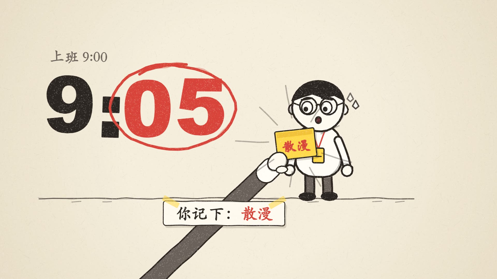

# 心理学短视频画风引擎

用代码一帧一帧“画”出心理学科普短视频：不用剪辑软件，不用素材库。画面、角色、字幕、音效全部由程序生成，改一行台词就能重新出片。

仓库里是五套画风，每一套都做出过一集完整的抖音短视频（35–43 秒）。

| 画风 | 效果 | 用在哪一集 |
|---|---|---|
| **舞台追光** `stage-spotlight` |  | 聚光灯效应：全场都在看你吗 |
| **旧档案胶片** `archive-film` |  | 服从权威：你按到第几个 |
| **超市 POP 价签** `pop-price-tag` |  | 锚定效应：你以为是自己判断的 |
| **神秘塔罗** `mystic-tarot` |  | 巴纳姆效应：被说中不代表被看穿 |
| **拟手绘** `hand-drawn` |  | 第一印象：0.1 秒你就给他打了分 |

## 每套画风的做法

- **舞台追光**：每个镜头先画全彩的布景，再乘一张“光照图”。追光照到的地方有颜色，其余变成深蓝剪影，最后叠上光束里的雾和灰尘。
- **旧档案胶片**：整体去色成 1960 年代录像的棕黑色，只有电压表、红灯这类“红色发光层”保留颜色。再叠胶片颗粒、划痕、片门抖动和暗角。
- **超市 POP 价签**：荧光卡纸配马克笔。黑色粗描边，填色故意错位，数字是逐笔写出来的“泡泡字”。整个画面每秒轻微扭动 8 次，像手绘动画的“沸腾线”。
- **神秘塔罗**：在舞台追光的基础上做成占卜氛围，有星盘、原创塔罗牌、金线小人和烛光。
- **拟手绘**：米白纸面配铅笔线。线条每秒抖动 8 次，用蓝、红、黑三色，再加黄色荧光笔做强调。

## 设计思路

- **每一帧都能单独算**：`render(t)` 只依赖时间 `t`，所以可以多进程并行渲染，也能直接跳到任意一秒检查画面。
- **场景和引擎分开**：`engine.js` 是画风本身（画笔、光照、滤镜），`scenes/` 里是这一集的剧情。换一集只需要重写 `scenes/film.js`。
- **音效跟着画面走**：页面在关键动作处登记事件（`window.EV`），`mix.py` 按这些时间点用程序合成音效，不用任何音频素材。
- **自动检查字幕读速**：`render/readcheck.mjs` 会检查每句字幕停留的时间够不够读完（中文按每秒 6 个字算）。

## 目录结构

```
render/              渲染工具（无头浏览器逐帧截图 → ffmpeg 编码）
styles/<画风>/
  index.html         页面入口，1920×1080 canvas
  engine.js          画风引擎
  scenes/            角色、道具、剧情（film.js）、封面
  mix.py             按事件合成音效
  tools/             音效库、字幕导出等
build.sh             一键出片
```

## 怎么运行

需要 Node.js 20+、Python 3.10+ 和 ffmpeg。

```bash
npm install
npm run setup
pip install -r requirements.txt
sh build.sh stage-spotlight 全场都在看你吗
```

成片、字幕和封面会输出到 `styles/<画风>/out/`。

只想看某一帧，可以单独截图：

```bash
node render/still.mjs styles/hand-drawn 6 --out styles/hand-drawn/out/stills
```

> “神秘塔罗”用到两款开源字体，需要自己下载，见 `styles/mystic-tarot/fonts/README.md`。

## 致谢

`render/` 中的逐帧渲染工具来自 [lemo-opuscar](render/LICENSE-lemo-opuscar)（MIT）。所有画风引擎、角色和剧情都是本仓库原创。

## 许可证

MIT
